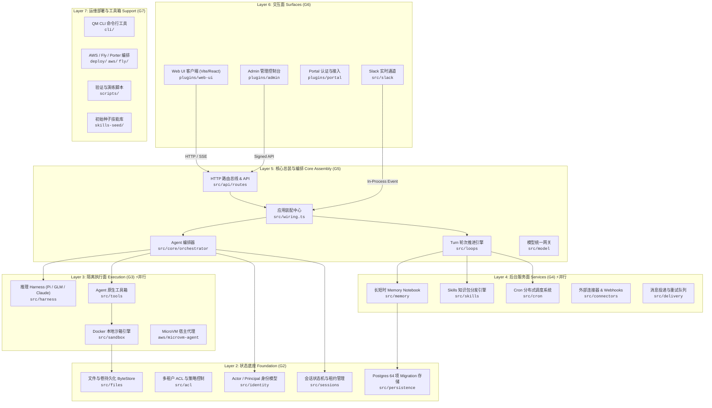

# QM 系统整体架构图与分层拓扑 (G1 交付物)

> **所属门控**：`G1` (拆解与装配地图)  
> **关联基线**：上游提交 `8ac53f7a` (2,212 文件全量索引)  
> **图谱索引**：`codebase-memory-mcp` (28,272 节点, 146,761 条图关系边)

---

## 1. 架构总览图 (Mermaid 分层架构)

QM 是一个面向生产环境的高保真 Agentic 工作流运行引擎，具备多租户身份隔离、双轨沙箱执行、全生命周期持久化与多端 Surface 接入能力。全仓按职责解耦为六大核心层级：

---

## 2. 核心模块职责与门控映射

| 层次编号 | 逻辑层次 | 对应门控 | 文件数 | 核心职责与关键抽象 |
| :--- | :--- | :--- | :--- | :--- |
| **Layer 2** | **状态底座 (Foundation)** | **G2** | 254 | • **身份体系**：`ActorAssertion`, `Principal`, `ScopeId`, `DirectoryMember`。 • **权限策略**：基于 Scope 的读写 ACL 判定与租约仲裁。 • **持久化底座**：Postgres 连接池、64 个 Migration 脚本（65 张核心业务表）。 • **存储接口**：`SessionStore`, `RunStore`, `DurableByteStore`。 |
| **Layer 3** | **隔离执行面 (Execution)** | **G3** | 121 | • **模型适配**：`ClaudeHarness`, `CodexHarness`, `PiHarness`, `MockHarness`。 • **容器沙箱**：基于 Docker/WSL2 的双轨隔离（`qm-sandbox-local`）、冷热启动与卷持久挂载。 • **工具执行**：`execute`, `file_read`, `file_write`, `inspect_process` 原语。 |
| **Layer 4** | **后台服务面 (Services)** | **G4** | 179 | • **Memory**：Per-turn / Agent-only / Scratch-promote 记忆流。 • **Skills**：Skill pack 动态加载、安全校验与语义物化。 • **Cron**：分布式定时任务调度、租约抢占与触发器防重。 • **Delivery**：异步事件通知与降级重试。 |
| **Layer 5** | **核心总装 (Core Assembly)** | **G5** | 207 | • **系统总线**：`src/wiring.ts` 负责单例工厂与全系统依赖倒置组装。 • **HTTP 协议**：RESTful 路由、SSE 流式打字机响应、鉴权中间件。 • **Turn 调度**：多轮会话状态机驱动、Token 预估与预算控制。 |
| **Layer 6** | **交互端面 (Surfaces)** | **G6** | 612 | • **Web UI**：聊天工作区、文件浏览器、审批卡片、Timeline 展示。 • **Admin**：租户管理、模型配额配置、审计日志分析、凭证托管。 • **Slack**：Slack Socket Mode / Managed Webhook 事件双向桥接。 |
| **Layer 7** | **运维支撑 (Operations)** | **G7** | 837 | • **命令行**：`qm` 二进制 CLI 工具箱。 • **云端编排**：AWS ECS/ALB、Fly.io、Porter 部署模板。 • **交付测试**：端到端用例、压力测试与演练工具。 |

---

## 3. 架构关键热点与图谱指标 (Codebase Memory 证据)

通过 `codebase-memory-mcp` 的知识图谱分析：

1. **核心装配中心**：`src/wiring.ts`（包含 180 个向外装配调用），作为全系统唯一正式依赖注入点，严格保证无全局静态单例污染。
2. **核心领域约束**：`src/types.ts` 中的 `ScopeId` 具有 336 个扇入引用，确保所有文件、内存、运行状态在多租户上下文下严格隔离。
3. **高频错误边界**：`src/util/errors.ts`（176 处引用）与 `src/api/http.ts:sendJson`（304 处引用）构成标准统一的出错防护网。
