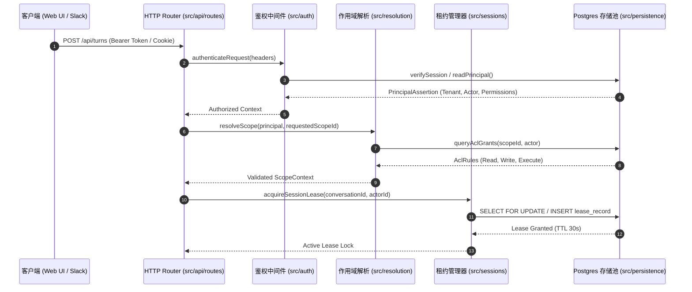
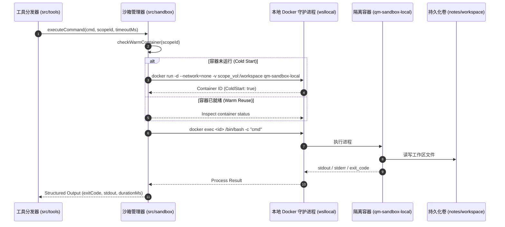

# QM 核心运行时调用链与时序追踪 (G1 交付物)

> **所属门控**：`G1` (拆解与装配地图)  
> **分析工具**：`codebase-memory-mcp:trace_path` / `query_graph`

---

## 1. 核心链路 1：HTTP 请求准入与会话租约分配

当客户端发起 `/api/turns` 或进入会话时，系统执行严格的身份鉴定、租户作用域解析与租约抢占：



---

## 2. 核心链路 2：Agent 核心执行与模型推理流 (Turn Loop)

核心执行调度器控制大模型多轮思考与工具调用分支：

```mermaid
sequenceDiagram
    autonumber
    participant App as 核心装配层 (src/wiring)
    participant Loop as Turn Loop (src/loops)
    participant Context as 上下文构建 (src/memory / skills)
    participant Harness as 模型 Harness (src/harness/pi)
    participant GLM as 大模型 API (Zhipu GLM-4 / Claude)
    participant Stream as SSE 流式推送 (src/api/sse)

    App->>Loop: dispatchTurn(turnPayload, scopeContext)
    Loop->>Context: assemblePromptContext(conversationId)
    Context-->>Loop: SystemPrompt + History + Skills + MemoryNotebook
    
    Loop->>Harness: runInference(assembledMessages, toolSpecs)
    Harness->>GLM: POST /chat/completions (Stream: true)
    
    loop 流式 Token 接收
        GLM-->>Harness: delta chunk
        Harness->>Stream: emitToken(chunk)
        Stream-->>Client: data: chunk
    end
    
    alt 模型发起工具调用 (Tool Call)
        GLM-->>Harness: tool_call (name, args)
        Harness-->>Loop: ToolCallRequest
        Loop->>Tools: dispatchToolExecution()
    else 模型完成回答
        GLM-->>Harness: stop_reason: "end_turn"
        Harness-->>Loop: TurnCompleted
    end
```

---

## 3. 核心链路 3：本地 Docker 隔离沙箱工具执行

针对敏感命令与代码运行，通过本地 Docker 容器进行双轨隔离：



---

## 4. 核心链路 4：状态回写、审计日志与流式交付

每轮执行完毕后，执行副作用原子落盘并广播更新：

```mermaid
sequenceDiagram
    autonumber
    participant Loop as Turn Loop (src/loops)
    participant Audit as 审计与监控 (src/admin)
    participant Memory as 记忆提取 (src/memory)
    participant PG as Postgres 数据库
    participant Delivery as 外部投递 (src/delivery)

    Loop->>PG: INSERT INTO turns (turn_id, messages, status)
    Loop->>PG: INSERT INTO session_messages (...)
    Loop->>Audit: recordAuditEvent(actor, toolCalls, duration)
    Audit->>PG: INSERT INTO audit_events (...)
    
    Loop->>Memory: extractTurnMemories(turnContext)
    Memory->>PG: INSERT INTO memory_revisions (...)
    
    Loop->>Delivery: notifySubscribers(conversationId)
    Delivery->>Client: SSE Event: 'turn.completed'
```
