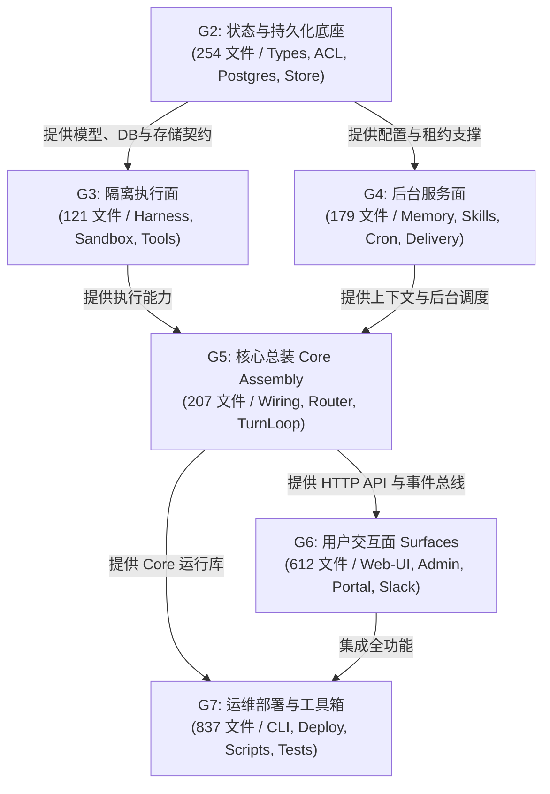

# QM 模块依赖图谱、导入分类与环依赖分析 (G1 交付物)

> **所属门控**：`G1` (拆解与装配地图)  
> **静态与类型分析**：全仓 2,214 文件，6,817 处内部引用边

---

## 1. 导入类型深度解构与统计

根据 G1 实施步骤 2 要求，全仓文件依赖已按五大导入类型严格分类标记：

| 导入类型标识 | 匹配语法规范 | 出现频次 | 运行时性质 | 架构影响说明 |
| :--- | :--- | :--- | :--- | :--- |
| **`static`** | `import { X } from '...'` | **9,268** | **强运行时依赖** | 模块加载时同步求值，决定初始化严格拓扑顺序。 |
| **`type_only`** | `import type { T } from '...'` | **1,782** | **仅编译期依赖** | TypeScript 编译为 JS 时彻底消除，**不产生运行时循环**。 |
| **`dynamic`** | `import('...')` | **386** | **延迟加载依赖** | 运行时异步动态解析，用于可选 Provider 与插件按需加载。 |
| **`require`** | `require('...')` | **69** | **CJS 兼容运行时** | 原生 Node.js 动态载入，主要集中在构建脚本与老旧适配层。 |
| **`fs_read`** | `fs.readFileSync(...)` | **22** | **物理资产依赖** | 读取 SQL migration、模板 HTML 与默认 seed 配置。 |

---

## 2. 跨门控有向无环图 (Gate DAG)

QM 的门控推进顺序严格遵循物理运行依赖闭包：

### 关键拓扑特性验证：
1. **G3 与 G4 完全正交**：G3（沙箱与执行引擎）与 G4（记忆与技能管理）之间**不存在任何单向或双向运行时依赖**，完全支持双 Agent 并行开发！
2. **G2 是全局严格拓扑源**：所有执行面与服务面均依赖 G2 定义的 `types.ts`, `persistence`, `identity`，因此 G2 必须在 G3/G4 之前串行完成。
3. **G5 是统一总装汇聚点**：G5 仅在 G3 与 G4 均通过后接入，完成完整的端到端闭环。

---

## 3. 强连通分量 (SCC) 环依赖分析

使用 Tarjan 算法对全仓依赖进行强连通分量求解：

### 3.1 运行时环依赖（Runtime SCCs）—— 仅 3 组且均严格内聚！

当剥离 `type_only` 编译期纯类型引用后，全仓的**运行时循环依赖仅存在 3 组**，且**全部被严格限制在各自门控内部**：

| SCC ID | 环规模 | 所属 Gate | 涉及核心文件 | 解环策略与恢复规则 |
| :--- | :--- | :--- | :--- | :--- |
| **SCC-R1** | 2 文件 | **G7 (CLI)** | `cli/src/sandbox-layer.ts` `cli/src/deployment-layer.ts` | CLI 部署与沙箱层相互配置。在 G7 恢复时同批提交即可。 |
| **SCC-R2** | 21 文件 | **G6 (Web-UI)** | `plugins/web-ui/src/memory.ts` `plugins/web-ui/src/settings.ts` `plugins/web-ui/src/search.ts` `plugins/web-ui/src/calendar.ts` 等 | Web UI 前端状态管理交叉订阅。G6 内部整体恢复，不影响 Core。 |
| **SCC-R3** | 2 文件 | **G5 (Core)** | `src/model/pi-models.ts` `src/model/custom-providers.ts` | 自定义 Provider 与 Pi 模型工厂的互注册。在 G5 汇聚时同批装配。 |

> **关键架构结论**：
> **全仓不存在任何跨门控（Cross-Gate）的运行时循环依赖**！这为门控的干净拆分与单向渐进拼回提供了 100% 的拓扑安全保证。

### 3.2 编译期类型环依赖（Type-level SCCs）
全图包含 13 个全量环（包含 `import type`），其中最典型的如：
- `src/security/security-posture.ts` <-> `src/resolution/sharing-posture.ts` <-> `src/types.ts`（均为 G2 内部类型互引）。
在 TypeScript 下，通过接口提取和 `import type` 语法已在底层实现了解耦。
