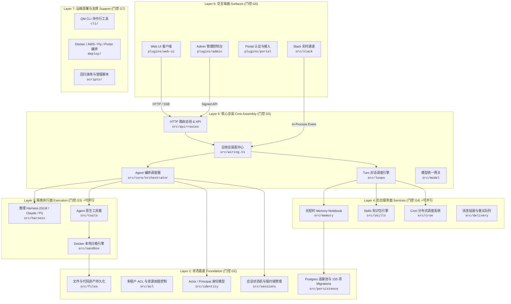
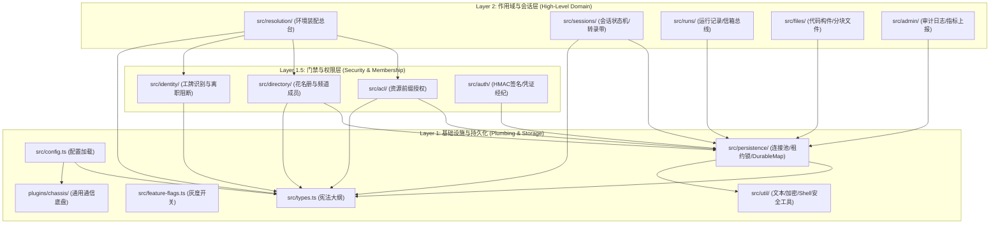
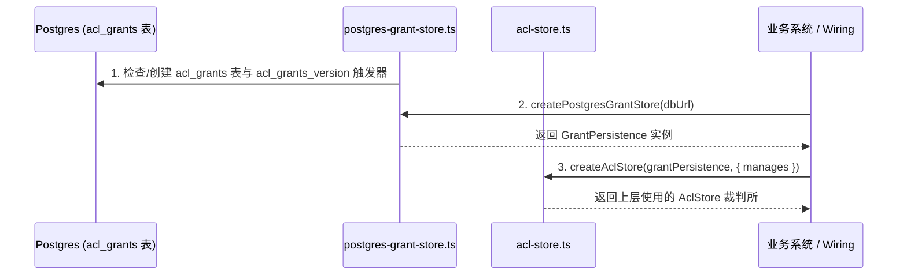
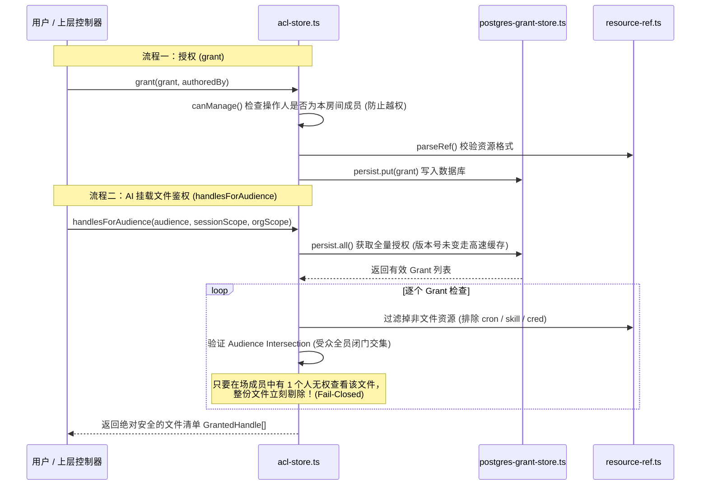

# QM 核心模块架构与依赖全景指南 (QM_MODULE_GUIDE.md)

> **面向对象**：后续接力的 AI Agent 与人类架构师。  
> **文档目标**：系统性梳理 **阶段 1 (G1 拆解地图)** 与 **阶段 2 (G2 状态底座)** 的核心模块职责、内部文件调用时序与跨层依赖拓扑。  
> **使用方法**：接手任务时先读本指南，即可瞬间看清全系统卡扣与内部逻辑流动，杜绝盲人摸象与反向循环依赖。

---

## 目录索引

- [第一篇：阶段 1 (G1 拆解与装配地图) 宏观依赖全景](#第一篇阶段-1-g1-拆解与装配地图-宏观依赖全景)
  - [1.1 全系统 6 层架构总览 (Layer 2 ~ Layer 7)](#11-全系统-6-层架构总览-layer-2--layer-7)
  - [1.2 全局神经装配中枢：src/wiring.ts](#12-全局神经装配中枢srcwiringts)
  - [1.3 核心依赖解耦发现：G3 隔离执行面与 G4 后台服务面零运行时依赖](#13-核心依赖解耦发现g3-隔离执行面与-g4-后台服务面零运行时依赖)
  - [1.4 环依赖 (Tarjan SCC) 求解结论](#14-环依赖-tarjan-scc-求解结论)
  - [1.5 G1 六大控制图纸索引与职责对照](#15-g1-六大控制图纸索引与职责对照)
- [第二篇：阶段 2 (G2 身份、作用域与状态底座) 核心模块详解](#第二篇阶段-2-g2-身份作用域与状态底座-核心模块详解)
  - [2.1 基础设施与领域宪法 (Types, Config, Chassis & Utils)](#21-基础设施与领域宪法-types-config-chassis--utils)
  - [2.2 身份识别与组织花名册 (src/identity/ & src/directory/)](#22-身份识别与组织花名册-srcidentity--srcdirectory)
  - [2.3 权限裁判所与调用链时序 (src/acl/)](#23-权限裁判所与调用链时序-srcacl)
  - [2.4 对话环境装配中枢 (src/resolution/)](#24-对话环境装配中枢-srcresolution)
  - [2.5 数据库与分布式抢麦租约 (src/persistence/)](#25-数据库与分布式抢麦租约-srcpersistence)
  - [2.6 会话状态机、转录带与任务信箱 (src/sessions/ & src/runs/)](#26-会话状态机转录带与任务信箱-srcsessions--srcruns)
  - [2.7 文件资产、工作区与审计监控 (src/files/ & src/admin/)](#27-文件资产工作区与审计监控-srcfiles--srcadmin)
- [第三篇：G1 到 G2 演进的装配工程规范](#第三篇g1-到-g2-演进的装配工程规范)

---

# 第一篇：阶段 1 (G1 拆解与装配地图) 宏观依赖全景

G1 阶段的目标是将包含 **2,214 个源文件**的庞大 QM 上游基线彻底解构，梳理出清晰的卡扣图纸，证明其模块解耦可行性。

## 1.1 全系统 6 层架构总览 (Layer 2 ~ Layer 7)



---

## 1.2 全局神经装配中枢：src/wiring.ts
* **全系统唯一合法总线**：经 `codebase-memory-mcp` 分析，`src/wiring.ts` 拥有 **180 处向外依赖倒置装配**。
* **职责**：
  * 作为依赖注入容器（DI Container），负责把底层的持久化 Store、模型 Harness、沙箱 Sandbox、定时 Cron 实例化并注入到顶层的 Orchestrator 与 HTTP Router 中；
  * **铁律**：除 `src/wiring.ts` 外，底层任何模块（如 `src/acl/`, `src/persistence/`）严禁反向引用上层应用逻辑，保持纯净单向依赖。

---

## 1.3 核心依赖解耦发现：G3 隔离执行面与 G4 后台服务面零运行时依赖
这是 G1 拆解分析中取得的**重大架构突破**：
* **解耦事实**：`src/harness/`、`src/sandbox/`、`src/tools/`（执行面 G3）与 `src/memory/`、`src/skills/`、`src/cron/`（服务面 G4）之间，**没有任何一条运行时依赖边**；
* **工程价值**：在 G2 状态底座就绪后，**G3 与 G4 可以由不同的 Agent 或团队以完全独立的分支双轨并发推进**，互不干扰，装配速度直接翻倍！

---

## 1.4 环依赖 (Tarjan SCC) 求解结论
通过对全仓 9,268 处静态导入与 1,782 处类型导入进行强连通分量（SCC）算法分析：
* **全仓无任何跨门控运行时环**；
* 仅存在 3 组局限在单模块内部的内聚环（如前端 Web-UI 内部组件引用）；
* **结论**：自底向上的分层构建在拓扑数学上完全成立，绝不会出现“A 等 B，B 等 A”的死锁情况。

---

## 1.5 G1 六大控制图纸索引与职责对照

| 图纸文件 | 大白话职责 | 核心作用 |
| :--- | :--- | :--- |
| [`G1_ARCHITECTURE.md`](file:///C:/Users/root/orca/workspaces/qm-rebuild/gate-g02-foundation/G1_ARCHITECTURE.md) | **系统立体透视图** | 定义 Layer 2 ~ Layer 7 六大逻辑层级及各层职责边界。 |
| [`G1_CALL_CHAINS.md`](file:///C:/Users/root/orca/workspaces/qm-rebuild/gate-g02-foundation/G1_CALL_CHAINS.md) | **流水线时序图** | 详述 HTTP 准入、Turn Loop 调度、Docker 沙箱隔离与持久化 4 大调用链路。 |
| [`G1_DEPENDENCY_GRAPH.md`](file:///C:/Users/root/orca/workspaces/qm-rebuild/gate-g02-foundation/G1_DEPENDENCY_GRAPH.md) | **零件卡扣拓扑图** | 梳理 9,268 处静态引用与强连通环，证明 G3/G4 完全解耦。 |
| [`G1_RESTORE_MANIFEST.md`](file:///C:/Users/root/orca/workspaces/qm-rebuild/gate-g02-foundation/G1_RESTORE_MANIFEST.md) | **领料清单** | 2,214 个文件按 G2~G7 明确分配，给出精确 `git checkout` 指令。 |
| [`G1_VERIFICATION_MATRIX.md`](file:///C:/Users/root/orca/workspaces/qm-rebuild/gate-g02-foundation/G1_VERIFICATION_MATRIX.md) | **质检大纲** | 规定 G0~G12 每一关的准入准出标准、实测命令与证据要求。 |
| [`G1_SUMMARY.md`](file:///C:/Users/root/orca/workspaces/qm-rebuild/gate-g02-foundation/G1_SUMMARY.md) | **技术总结** | G1 通关证据与交接指引。 |

---

# 第二篇：阶段 2 (G2 身份、作用域与状态底座) 核心模块详解

G2 是整个系统的“水泥地基”，共包含 **254 个核心文件**，确立了多租户隔离、权限仲裁、数据库持久化与并发单写者租约锁机制。



---

## 2.1 基础设施与领域宪法 (Types, Config, Chassis & Utils)

### A. src/types.ts（领域模型宪法）
* **强类型 `ScopeId` 体系**：
  * 彻底拒绝将用户 ID 与对话环境混为一谈；
  * `ScopeId` 涵盖：`org:*`（公司级）、`group:web-project-*`（封闭作战室）、`dm:*`（单人私聊）、`channel:*`（群聊频道）；
  * 保证不同租户与不同项目之间的数据在编译器级别就无法混淆。
* **主体工牌 `Principal`**：
  * `{ id: string, type: 'internal' | 'guest' | 'bot' }`；
  * 区分谁是内部员工、谁是外部 Slack Connect 访客、谁是后台调度机器人。
* **会话时序 `Session`**：
  * 包含单调递增序列号 `seq`、会话状态（`idle`, `working`, `awaiting_input`, `error`）、转录带指针与租约持有者。

### B. src/config.ts & src/feature-flags.ts
* **配置加载 (`src/config.ts`)**：集中解析 `.env` 环境变量，校验数据库 URL、模型网关地址与密钥；
* **灰度电闸 (`src/feature-flags.ts`)**：
  * 提供 `FeatureFlagStore` 接口；
  * 支持对指定 `ScopeId` 单独开启实验性特性（如 `persistent_subagents` 或 `command_scoped_credentials`）；
  * 后台由 `DurableMap` 存入数据库，热插拔生效，无需重启应用。

### C. plugins/chassis/（标准通信底盘）
* **架构定位**：外部插件（`plugins/web-ui`, `plugins/admin`, `plugins/portal`）与核心（`src/`）之间的通用转换插头；
* **三大铁律**：
  1. 纯源码包，**零外部第三方 npm 依赖**；
  2. **绝对不引用核心 `src/` 的代码**；
  3. 插件独立镜像打包时只需复制 `plugins/chassis/` 即可独立运行。
* **核心部件**：
  * `source-auth-sign.ts`：请求防伪 HMAC 签名计算；
  * `core-client.ts`：插件调用核心的标准化 HTTP 客户端；
  * `errors.ts`：统一错误报文结构体定义。

### D. src/util/*（安全工具箱）
* `text.ts`：处理 Unicode 代理对，防中文字符中途截断造成 Postgres JSONB 写入崩溃；
* `crypto.ts`：恒定时间比对 `constantTimeEqual`（防时序攻击）、防碰撞哈希 `hashId`；
* `shell.ts`：Shell 命令行参数防注入转义工具 `shq`。

---

## 2.2 身份识别与组织花名册 (src/identity/ & src/directory/)

### A. src/identity/（身份核验中心）
* `identity-service.ts`：
  * 对所有调用方进行身份划分：同域名成员 ➡️ `internal`；跨公司人员 ➡️ `guest`；
  * **Fail-Closed 离职阻断机制**：维护 `DeactivationRecord` 列表，离职人员邮箱经大小写折叠（Case-Fold）处理后永久阻断，携带历史凭证也瞬间拒绝。
* `external-members.ts`：登记第三方合作方成员，杜绝跨企业资源越权。

### B. src/directory/（组织架构与频道花名册）
* `directory-store.ts`：
  * 维护公司全量人员名册、公开频道、私有频道与多人群聊成员列表；
  * **智能模糊寻址**：在聊天输入 `@张三` 时支持前缀匹配，同名时主动报告歧义候选列表而不是盲目执行。
* `postgres-directory-store.ts`：
  * **时间戳防旧数据倒灌**：外部异步同步组织架构时，如果快照时间戳落后于数据库当前版本，数据库严格拒收（`refused stale swap`），保证因果时序单调向前。

---

## 2.3 权限裁判所与调用链时序 (src/acl/)

`/acl` 目录由 3 个协同文件构成：
```text
src/acl/
├── resource-ref.ts        # 1. 资源统一编码器
├── acl-store.ts           # 2. 核心鉴权裁判所
└── postgres-grant-store.ts # 3. PostgreSQL 持久化与版本高速缓存
```

### A. 启动装配顺序（自底向上）


### B. 运行时调用：授权与受众全员安全门槛判定


---

## 2.4 对话环境装配中枢 (src/resolution/)

`src/resolution/resolution-service.ts` 是连接外部对话与底层工作区的总调度台：

* **双层工作区安全挂载法**：
  * **单人私聊（DM）**：挂载 `[org, personal]` 两层工作区，用户可以自由访问自己的个人私密笔记；
  * **多人频道/群聊（Channel）**：挂载 `[org, channel]` 两层工作区，**严禁挂载个人的 personal 工作区**，从根源上杜绝在团队频道中误读个人隐私文件。
* **受众底线 (Audience Floor)**：
  * 自动结合房间所有成员的身份属性，动态计算本轮对话允许访问的外网白名单（Egress Policy）与敏感词屏蔽门槛。

---

## 2.5 数据库与分布式抢麦租约 (src/persistence/)

### A. 数据库连接池与事务迁移 (src/persistence/pg-pool.ts)
* 统一封装 Node.js `pg.Pool` 连接池；
* 维护 `qm_schema_migrations` 迁移注册表，确保 155 项表结构变更在多实例部署下**幂等、安全、原子执行**。

### B. 分布式单写者租约锁 (src/persistence/leader-lease.ts & advisory-lock.ts)
* **业务痛点**：多台服务器或多个进程同时并发写同一个会话，会导致历史记录错乱；
* **实现方案**：
  * 基于 PostgreSQL Advisory Lock 事务级行锁；
  * 写入者必须先调用 `acquireLease()` 拿到麦克风；
  * 持有者必须定时发起心跳续期（`renewLease()`）；
  * 若持有者死机，超时后自动释放；支持 Reaper 进程强制接管，绝不死锁。

### C. 通用持久化安全表 (src/persistence/durable-map.ts)
* 提供标准 `DurableMap<T>` KV 存储接口；
* 维护 `durable_map_versions` 版本表，数据变动自动通知缓存刷新；
* 序列化时严格清洗 NUL 字符（`\u0000`）与孤立代理对，保证任何奇怪的特殊符号都不会破坏 PostgreSQL JSONB 存储。

### D. 跨实例状态总线 (src/persistence/postgres-listener.ts)
* 基于 PostgreSQL `LISTEN/NOTIFY` 机制；
* 在多服务器节点间以零延迟实时广播会话状态变更与唤醒信号。

---

## 2.6 会话状态机、转录带与任务信箱 (src/sessions/ & src/runs/)

### A. 会话核心状态机 (src/sessions/postgres-session-store.ts)
* **单调递增时序 (`seq`)**：会话内的每一次发言、工具调用、思考过程均赋予全局自增整数序号，保证因果历史不可篡改；
* **参与者可见性窗口 (Participant Tenure Window)**：
  * 精确记录成员的加入与退出时间段：`[valid_from, valid_to)` 与 `[valid_from_seq, valid_to_seq]`；
  * **智能遮光罩**：新人进群看不到进群前的历史对话，离职退群看不到退出后的未来对话；
  * 隔离 overheard 旁路消息，保护会话私密性。

### B. 子智能体任务信箱 (src/sessions/session-syscalls.ts & session-mailbox.ts)
* 当主智能体派发耗时的复杂子任务时，通过系统调用（Syscalls）派生独立的子会话；
* 子智能体在自己的独立线程中执行，任务完成后将最终结果封装为信封，投递回主会话的信箱（Mailbox），主智能体无需轮询即可直接接收处理。

---

## 2.7 文件资产、工作区与审计监控 (src/files/ & src/admin/)

### A. 多租户文件与构件存储 (src/files/)
* `postgres-file-artifact-store.ts`：管理多租户代码构件，记录 SHA-256 哈希与版本历史；
* `file-upload-store.ts`：支持大文件分块断点上传，防止网络抖动传输失败。

### B. 审计日志与监控 Sink (src/admin/)
* `postgres-audit-log.ts`：记录每一次关键授权、角色变更、敏感文件访问，支持管理员按 Scope 溯源倒查；
* `postgres-error-log.ts` & `postgres-metrics-sink.ts`：持久化系统运行错误栈与性能度量指标。

---

## 2.8 统一数据库迁移与开箱初始化 (scripts/migrate.mjs)

`scripts/migrate.mjs` 是 QM 底座面对生产部署与本地研发时的全量数据库初始化中枢：
* **注册制 Schema 管理**：自动装载各个存储模块（`GrantStore`, `AdminGrantStore`, `AuditLog`, `DirectoryStore`, `FileArtifactStore`, `SessionStore`, `RunStore`, `RunActivityStore`, `RunSignalStore`, `BrokerSessions`, `ReplayDedupe`, `EnvironmentStore`, `DurableMap`, `ErrorLog`, `MetricsSink`）；
* **幂等执行 (Idempotent)**：通过 `qm_schema_migrations` 追踪 57 项原子级增量迁移；即使反复执行 `npm run migrate`，系统保证 0 冲突、49 张核心表秒级对齐并处于随时就绪状态。

---

# 第三篇：G1 到 G2 演进的装配工程规范

在 QM 重建过程中，必须严格遵循以下铁律：

1. **零代码注释规范（Zero Comments）**：
   * 代码文件中严禁包含解释性注释、TODO、FIXME、lint/type 抑制指令或被注释的代码；
   * 通过严谨的命名、清晰的模块划分与完整的测试用例表达工程意图；
   * 业务解释与架构设计全部记录在像本指南一样的根目录规范 Markdown 文档中。
2. **零 AI 归属声明（No AI Attribution）**：
   * Git Commit 严禁添加 `Co-authored-by: AI` 或 `Generated with...` 等 AI 生成尾注，保持纯净提交历史。
3. **状态默认持久化（Durable by Default）**：
   * 严禁将关键状态（如权限、会话历史、任务队列）仅保存在内存 `Map` 中；
   * 内存仅允许用作只读缓存，所有核心数据必须由 PostgreSQL 或物理卷承载。
4. **叶子依赖闭包原则**：
   * 恢复某个功能模块时，必须将其底层的类型与辅助叶子模块一并恢复，保证编译期与运行时模块解析 100% 严丝合缝闭合，严禁制造临时 mini-runtime 伪实现。

---

# 第四篇：Gate 2 分步装配与交付台账（Step 1 ~ Step 6 全量审计）

为了让团队及后续介入的 Agent 一目了然每次迭代的具体交付，下表汇总了 Gate 2 在 `gate/g02-walkthrough` 分支上的全量分步实施明细：

| 阶段 / 步骤 | 提交哈希 | 核心恢复模块与文件 | 核心职责与关键业务机制 | 覆盖测试套件与结果 |
| :--- | :--- | :--- | :--- | :--- |
| **阶段一 (G1)**<br>宏观解构 | `0513c7c`<br>`245892d` | 全仓解构分析、`src/wiring.ts` 依赖拓扑 | 剖析 6 层单向依赖拓扑；确立 Tarjan 强连通分量 0 环路；梳理 180+ 外部依赖汇聚点并切断环路 | 架构图谱与拓扑映射 100% 闭环 |
| **Step 1**<br>类型与底盘 | `2157b14` | `src/types.ts`<br>`src/config.ts`<br>`src/feature-flags.ts`<br>`src/util/*`<br>`plugins/chassis/` | 1. 建立 `ScopeId`（`org`, `chan`, `dm`, `session`）类型安全隔离；<br>2. 确立 `plugins/chassis` 零外部依赖插件通信底盘；<br>3. 实现 Unicode 代理对安全截断、防时序攻击哈希与 Shell 防注入转义。 | 3 套件 / 10 测试<br>**(10/10 PASS)** |
| **Step 2**<br>身份与 ACL | `f09dba4` | `src/identity/`<br>`src/directory/`<br>`src/resolution/`<br>`src/acl/`<br>`src/auth/`<br>`src/policy/` | 1. `identity-service`：员工与访客身份划分，离职人员大小写折叠永久阻断（Fail-Closed）；<br>2. `directory-store`：组织花名册维护，支持前缀模糊寻址；<br>3. `acl-store`：全员受众闭门交集（Audience Intersection）鉴权；<br>4. `resolution-service`：私聊与频道双层工作区物理隔离。 | 6 套件 / 74 测试<br>**(74/74 PASS)** |
| **Step 3**<br>DB与抢麦租约 | `b831ef9` | `src/persistence/pg-pool.ts`<br>`src/persistence/leader-lease.ts`<br>`src/persistence/advisory-lock.ts`<br>`src/persistence/durable-map.ts`<br>`src/persistence/postgres-listener.ts` | 1. `pg-pool`：连接池管理与 57 项原子级增量 Schema 迁移引擎；<br>2. `leader-lease`：基于 Postgres Advisory Lock 实现单写者抢麦与心跳续期，防多实例写冲突；<br>3. `durable-map`：版本化持久 KV 存储，清洗 NUL 字符防 JSONB 损坏；<br>4. `postgres-listener`：基于 LISTEN/NOTIFY 的毫秒级跨节点状态总线。 | 4 套件 / 23 测试<br>**(23/23 PASS)** |
| **Step 4**<br>会话状态机 | `9f68187` | `src/sessions/postgres-session-store.ts`<br>`src/sessions/session-syscalls.ts`<br>`src/sessions/session-mailbox.ts`<br>`src/runs/` | 1. 会话生命周期四状态机与单调自增时序 `seq`；<br>2. 参与者在场窗口 `[valid_from, valid_to)` 历史隔离遮光罩；<br>3. `session-syscalls`：子智能体任务派生与 Mailbox 异步信封投递。 | 6 套件 / 86 测试<br>**(86/86 PASS)** |
| **Step 5**<br>文件与审计 Sink | `1974647` | `src/files/postgres-file-artifact-store.ts`<br>`src/files/file-upload-store.ts`<br>`src/workspace/workspace-store.ts`<br>`src/admin/postgres-audit-log.ts`<br>`src/admin/postgres-error-log.ts`<br>`src/admin/postgres-metrics-sink.ts` | 1. 多租户文件隔离存储与 SHA-256 哈希校验；<br>2. 大文件分片上传状态机与过期租约轮转清理；<br>3. 双层工作区物理目录映射；<br>4. 租户级操作审计追踪、系统错误堆栈持久化与采样度量收集。 | 9 套件 / 68 测试<br>**(68/68 PASS)** |
| **Step 6**<br>迁移入口与回归 | `a4f116c` | `scripts/migrate.mjs`<br>`package.json` | 1. 注册全库 16 大持久化模块及 DurableMap 表结构；<br>2. `npm run migrate` 幂等执行，就绪 49 张核心数据表；<br>3. 全量 28 个测试套件端到端串行总回归。 | 28 套件 / 261 测试<br>**(261/261 PASS，100% 通过)** |

---
> 💡 *本指南作为全仓标准架构手册，将随 G3（隔离执行面）、G4（后台服务面）和后续门控的推进持续演进更新。*
